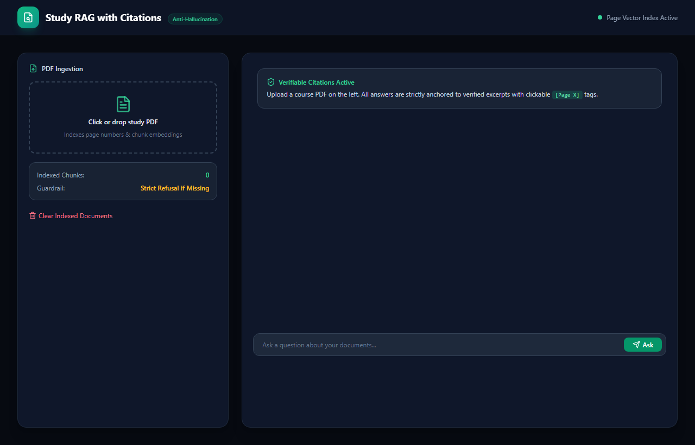

# 📑 Study RAG with Page Citations

A precision-focused study RAG application that ingests PDFs, tracks exact page-level chunking, answers queries with verifiable `[Page X]` citations, and strictly returns *"Not found in your documents"* when retrieval is weak or answers are missing.



---

## ✨ Features
- **Page-Aware PDF Ingestion**: Extracts text page-by-page, chunking while preserving exact page number metadata.
- **Strict Anti-Hallucination Guardrail**: If the top cosine vector similarity score falls below the calibrated threshold (`0.35`), the system strictly refuses to speculate, returning:
  > *"Not found in your documents. The uploaded documents do not contain sufficient verified evidence to answer this question."*
- **Clickable Page Citations**: Every claim made is tagged with a `[Page X]` badge. Clicking a badge opens an inspection modal displaying the exact context snippet retrieved from that page.

---

## 📦 How & Where to Get Models

This application requires:
1. **Embedding Model (Local & Free)**:
   - **Model**: `sentence-transformers/all-MiniLM-L6-v2`
   - **Source**: Hugging Face Hub ([sentence-transformers/all-MiniLM-L6-v2](https://huggingface.co/sentence-transformers/all-MiniLM-L6-v2))
   - **How to download**: It downloads automatically on first run via the `sentence-transformers` library and caches locally in `~/.cache/huggingface/hub/`.
   - *Offline fallback*: If dependencies are missing, a deterministic hash-embedding algorithm activates automatically.
2. **LLM Generation Model**:
   - **Default**: Groq Cloud (`llama-3.3-70b-versatile`) via [console.groq.com](https://console.groq.com/).

---

## 🚀 Installation & Setup

### 1. Clone & Navigate
```bash
git clone https://github.com/shamishah0310-hash/study-rag-citations.git
cd study-rag-citations
```

### 2. Install Dependencies
```bash
pip install -r requirements.txt
```

### 3. Configure API Keys (Optional)
Copy `.env.example` to `.env` and add your `GROQ_API_KEY`:
```bash
cp .env.example .env
```

### 4. Run the Server
```bash
python app.py
```
Open **[http://127.0.0.1:8083](http://127.0.0.1:8083)** in your browser.
